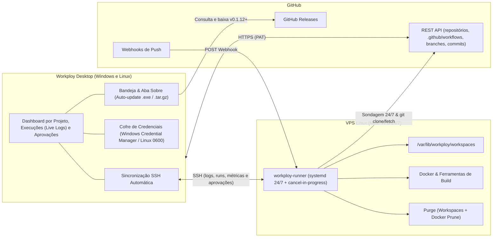

# Workploy

Orquestrador desktop em Rust para CI/CD e deploy self-hosted multi-VPS.

[](https://github.com/matheuswidder/w-workploy/releases)
[](app/Cargo.toml)
[](https://github.com/matheuswidder/w-workploy/releases)
[](LICENSE)

---

## Como funciona (VPS 24/7 + Painel Desktop)

O Workploy divide a execução contínua na sua infraestrutura do controle visual no seu computador:

- **Pipelines 24/7 na VPS (`workploy-runner`):** o agente roda como serviço `systemd` nas suas VPSs Linux. Seus builds e deploys seguem ativos com o computador desligado.
- **Painel Desktop (Windows e Linux):** o **Workploy Desktop** sincroniza os runs da VPS via SSH automaticamente ao abrir e organiza fluxos e execuções por projeto.
- **Visão ao vivo em Execuções e Dashboard do Projeto:** acompanhe **Live Logs** em tempo real (`stick_bottom`), jobs com sub-etapas expansíveis, KPIs por projeto e telemetria das VPSs (vCPU, RAM e disco).
- **Autorização com 1 clique na aba Aprovações:** etapas com **Portão de Aprovação** pausam na VPS antes da ação crítica e aparecem na aba **Aprovações** para você liberar ou cancelar o deploy com 1 clique.

Rodar pipelines nas próprias VPSs elimina limites de minutos em nuvem e mantém credenciais e código na sua rede.

## Novidades da v0.1.12

- **Importar do repositório (fonte da verdade):** commite o `.workploy.yml` na raiz do projeto (uma receita ou lista `workflows:`) ou em `infra/workploy/*.yml`, clique em **Importar do repositório** e revise o preview dos passos. Cada fluxo importado registra a proveniência (repo, caminho e SHA), oferece **Atualizar do repo** e o run exibe o aviso **"A receita mudou no repo"** quando o yml muda no repositório.
- **Spinners de fase nas execuções ativas:** cada fluxo em andamento mostra um indicador animado que acompanha a fase da execução — fluxos de CI/build usam a família `pulse` (2 pontos suaves, pontos em sequência, anéis que aceleram) e fluxos de deploy a família `blocks` (blocos subindo, alternando e a onda final). Os spinners aparecem na barra lateral (projetos e receitas aninhadas) e no detalhe da execução junto do status com o percentual de passos concluídos.
- **Projetos expansíveis na barra lateral:** o cabeçalho de cada projeto agora abre e fecha suas receitas aninhadas com um clique; a execução ativa continua visível no cabeçalho mesmo recolhido.
- **Ícones Solar temáveis:** a interface ganhou o conjunto Solar (Minimalistic Bold) renderizado na cor do texto do tema — branco no escuro, preto no claro — em servidores, aprovações, webhook, chaves SSH, cofre, lixeira e no plano ilimitado.

Novidades da v0.1.11 (incluídas nesta versão):

- **Importação direta de `.github/workflows/*.yml` com Jobs e Sub-etapas expansíveis:** importe workflows do GitHub Actions e visualize jobs agrupados por tipo (`Typecheck + Tests + Smoke`, `Secret scan`, `Contracts Zod`, `Deploy VPS`) com sub-etapas expansíveis, no mesmo padrão do GitHub Actions.
- **Sidebar agrupada por Projeto e Dashboard do Projeto:** navegue por projeto na barra lateral e abra o painel dedicado com KPIs de onde o projeto roda, recursos recomendados, tempo médio dos runs, taxa de sucesso e commits recentes.
- **Live Logs em tempo real (`stick_bottom`):** o painel de saída acompanha a última linha emitida e mantém a sub-etapa ativa visível durante toda a execução.
- **Sincronização automática com a VPS e controle de concorrência:** ao abrir o app ou alterar vínculos, o Workploy sincroniza configurações e histórico com a VPS; runs concorrentes na mesma branch são cancelados automaticamente via `cancel-in-progress`.
- **Suporte completo no Linux:** cofre local persistente com permissão `0600` e auto-update integrado via pacote `.tar.gz`.

## Primeiros passos: criando sua primeira automação em 3 minutos

1. **Conecte sua conta GitHub:** abra **Configurações → GitHub**, informe seu Personal Access Token (PAT) e clique em **Testar conexão** para carregar seus repositórios.
2. **Vincule o repositório ao destino:** clique em **Vincular** na linha do repositório (ou em **+ Novo vínculo**), defina a branch monitorada (`main`, `main,dev` ou `*`), escolha o destino (**Local** ou uma **VPS** cadastrada em **Configurações → VPS**) e selecione o modo de disparo (**Webhook 24/7 na VPS**, **Sondagem 24/7 na VPS** ou **Sondagem no Desktop**).
3. **Gere ou importe a receita:**
   - **Caminho rápido:** no card do projeto em **Execuções**, clique em **Gerar receita**. O Workploy lê `package.json`, `Cargo.toml` e `docker-compose.yml` no GitHub para montar os passos de validação e deploy.
   - **Arquivo YAML:** crie um `.workploy.yml` na raiz do projeto, importe um workflow existente de `.github/workflows/*.yml` por **Buscar fluxos no repo**, ou cole o conteúdo em **Importar YAML**.
4. **Execute e acompanhe:** clique em **Executar agora**, abra a execução para ver os jobs e sub-etapas com **Live Logs** em tempo real e autorize etapas críticas na aba **Aprovações** quando houver portão manual (`approval: true` ou `x-approval: true`).

## Guia de automações YAML

Para configurar pipelines avançados, consulte o guia completo em [`docs/AUTOMACOES_YAML.md`](docs/AUTOMACOES_YAML.md):

- Diferença entre **Receita** (o que executar) e **Vínculo** (onde e quando rodar: Local, VPS Linux, Webhook 24/7, Sondagem 24/7 e multi-branch).
- Importação de `.github/workflows/*.yml` e estruturação de **Jobs com Sub-etapas (`::workploy-substep::<Nome>`)** agrupadas em `Typecheck + Tests + Smoke`, `Secret scan`, `Contracts Zod` e `Deploy VPS`.
- **Importar do repositório (fonte da verdade):** commite o `.workploy.yml` na raiz (uma receita ou lista `workflows:`) ou em `infra/workploy/*.yml`, importe com preview dos passos e mantenha o repo como fonte: cada fluxo registra proveniência (repo, caminho e SHA), oferece **Atualizar do repo** e o run avisa **"A receita mudou no repo"**.
- Tabela de **requisitos estimados por tipo de projeto** (Node/Next.js monorepo, Rust/Cargo e Docker Compose) e dicas de diagnóstico para deploys em subpastas como `infra/api` ou `infra/web`.
- Exemplos prontos para copiar, encadeamento (`on_success` / `x-chain`) e portões de aprovação.

## Importar do repositório em 4 passos

Mantenha as receitas versionadas no próprio repo e trate o arquivo commitado como fonte da verdade:

1. **Commite o yml:** escreva um `.workploy.yml` na raiz do projeto (uma receita ou lista `workflows:`) ou um arquivo por receita em `infra/workploy/*.yml`.
2. **Vincule o repositório:** em **Configurações → GitHub**, clique em **Vincular** na linha do repositório.
3. **Importe:** clique em **Importar do repositório**, revise os ymls encontrados e o preview dos passos e confirme a importação.
4. **Mantenha sincronizado:** o fluxo importado registra repo, caminho e SHA e oferece **Atualizar do repo**; se o yml mudar no repo, o run exibe o aviso **"A receita mudou no repo"**.

O passo a passo completo, incluindo onde o Workploy procura os ymls e um exemplo pronto para copiar, está na seção **Importar do repositório (fonte da verdade)** do [`docs/AUTOMACOES_YAML.md`](docs/AUTOMACOES_YAML.md#4-importar-do-repositório-fonte-da-verdade).

## Principais recursos

| Recurso | Como funciona |
|---|---|
| **Sidebar por Projeto e Dashboard** | Agrupa receitas e execuções por repositório na barra lateral e exibe KPIs por projeto: destino ativo, recursos recomendados, duração média, taxa de sucesso e commits. |
| **Jobs, Sub-etapas e Live Logs** | Importa `.github/workflows/*.yml` e `.workploy.yml`, agrupa sub-etapas expansíveis por tipo e rola automaticamente (`stick_bottom`) acompanhando a última linha e a sub-etapa ativa. |
| **Motor 24/7 (`workploy-runner`)** | Serviço `systemd` provisionado em 1 clique na VPS (`/etc/workploy/config.json` e `/var/lib/workploy/runs.json`), com sincronização automática ao abrir o app, **Webhook na VPS**, **Sondagem 24/7** (mínimo 15 s) e cancelamento `cancel-in-progress` por branch. |
| **Workflows encadeados e Aprovações** | Executa etapas em sequência com portões manuais (`approval: true` / `x-approval: true` na aba **Aprovações**) e encadeamento (`on_success` / `x-chain`) no padrão **CI -> Portão de Aprovação -> Deploy VPS**. |
| **Multi-VPS via SSH e Telemetria** | Autentica por chave **Ed25519** (gerador integrado via `ssh-keygen`), alias do `~/.ssh/config` ou senha via `SSH_ASKPASS`. A sonda SSH coleta sistema operacional, arquitetura, vCPU, RAM, disco e ferramentas (`Git`, `Docker`, `Node`, `pnpm`, `Rust`, `workploy-runner`). |
| **Conexão GitHub e Cofre** | Salva o PAT e segredos no Cofre do Windows (`Windows Credential Manager`) ou no cofre local do Linux protegido com permissão `0600`. |
| **Regra de Limpeza (Purge)** | Remove workspaces antigos, caches de build (`target`, `node_modules`, `.next`, `.turbo`, `.parcel-cache`, `.cache`, `dist`, `build`) e cache/imagens do Docker por limite de execuções ou teto em **MB/GB**. |
| **Bandeja do sistema e auto-update** | Minimiza para a bandeja do sistema e baixa/aplica atualizações integradas pela aba **Sobre** no Windows (`.exe`) e no Linux (`.tar.gz`). |

## Arquitetura



## Instalação (Windows)

Baixe o pacote da versão `0.1.12` na página de [Releases](https://github.com/matheuswidder/w-workploy/releases):

- **`Workploy-Setup-0.1.12.exe`**: instalador nativo Win32 sem janela de console, com atalhos opcionais, registro em *Aplicativos Instalados* (`HKCU`) e desinstalador próprio.
- **`workploy-0.1.12-win64-portable.zip`**: pacote portátil com `portable.flag` para extrair e executar em qualquer pasta sem alterar o registro do Windows.

## Instalação (Linux x86_64)

Baixe o pacote `workploy-0.1.12-linux-x86_64.tar.gz` na página de [Releases](https://github.com/matheuswidder/w-workploy/releases) e execute o instalador incluído:

```bash
tar -xzf workploy-0.1.12-linux-x86_64.tar.gz
cd workploy-0.1.12-linux-x86_64
./install.sh
```

O script instala o binário em `~/.local/bin/workploy`, o ícone e o atalho `.desktop` no menu de aplicativos do usuário, e inclui `./uninstall.sh` para remoção completa. No Linux, tokens e senhas ficam salvos no cofre local do usuário com permissão restrita `0600`.

## Atualizações integradas

O Workploy verifica e aplica novas versões na interface em **Configurações → Sobre**:

1. Clique em **Buscar atualizações** para consultar a release oficial mais recente no GitHub.
2. Quando houver nova versão disponível, clique em **Baixar e instalar v0.1.12 agora** (ou na versão indicada).
3. No Windows, o app baixa o instalador oficial (`.exe`), aplica a atualização e reinicia. No Linux, o auto-update integrado baixa o pacote `.tar.gz`, substitui o binário instalado e reinicia o aplicativo.

## Compilação e desenvolvimento local

### Pré-requisitos

- Toolchain Rust com edição 2024 (`rustup`, `cargo`); no Windows, alvo `x86_64-pc-windows-msvc`
- Cliente OpenSSH (`ssh` e `ssh-keygen`) no `PATH` para conexões e geração de chaves Ed25519
- PowerShell (no Windows, para empacotar o instalador e o ZIP portátil)

### Verificação e testes

```powershell
cargo check --manifest-path app/Cargo.toml --all-targets
cargo check --manifest-path installer/Cargo.toml --all-targets

cargo clippy --manifest-path app/Cargo.toml --no-deps -p workploy --all-targets

cargo test --manifest-path app/Cargo.toml
cargo test --manifest-path installer/Cargo.toml
```

### Executar em desenvolvimento

```powershell
# Modo completo
cargo run --manifest-path app/Cargo.toml

# Modo demonstração com dados fictícios (sem configurar servidores ou tokens)
cargo run --manifest-path app/Cargo.toml -- --demo
```

### Gerar instalador e pacote portátil (Windows)

```powershell
powershell -NoProfile -ExecutionPolicy Bypass -File scripts/build-installer.ps1
```

O script [`scripts/build-installer.ps1`](scripts/build-installer.ps1) compila `app` e `installer` em modo release, gera `Workploy-Setup-0.1.12.exe` e `workploy-0.1.12-win64-portable.zip` em `dist/` e exibe o hash SHA-256 de cada arquivo.

## Estrutura do projeto

| Caminho | Função |
|---|---|
| [`app/`](app/) | Aplicação desktop em Rust (`app/src/`, `app/assets/` e `app/Cargo.toml`), engine de pipelines, cliente SSH, integração GitHub e agente `workploy-runner` |
| [`installer/`](installer/) | Instalador nativo Win32 (`workploy-setup`) com compressão e desinstalador |
| [`scripts/`](scripts/) | Automação de empacotamento e geração de hashes ([`build-installer.ps1`](scripts/build-installer.ps1)) |
| [`docs/AUTOMACOES_YAML.md`](docs/AUTOMACOES_YAML.md) | Guia prático de criação, importação e teste de automações `.yml` |
| [`README.md`](README.md) | Documentação principal de uso, instalação e build |
| [`LICENSE`](LICENSE) | Texto integral da licença MIT |

## Créditos

- Icons: Solar by 480 Design, CC BY 4.0

## Licença

Este projeto usa a licença **MIT**. Leia o texto completo em [`LICENSE`](LICENSE).
