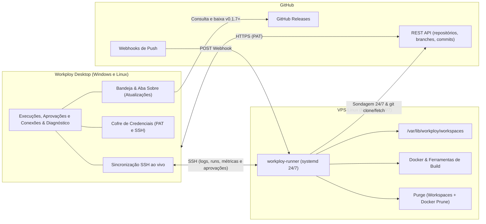

# Workploy

Orquestrador desktop em Rust para CI/CD e deploy self-hosted multi-VPS.

[](https://github.com/matheuswidder/w-workploy/releases)
[](app/Cargo.toml)
[](https://github.com/matheuswidder/w-workploy/releases)
[](LICENSE)

---

## Como funciona (VPS 24/7 + Painel Desktop)

O Workploy divide a execução contínua na sua infraestrutura do controle visual no seu computador:

- **Pipelines 24/7 na VPS (`workploy-runner`):** o agente roda como serviço `systemd` nas suas VPSs Linux. Seus builds e deploys seguem ativos mesmo com o seu computador desligado.
- **Painel central no Desktop (Windows e Linux):** o **Workploy Desktop** funciona como sua central de acompanhamento ao vivo e autorização. Ao abrir o aplicativo no Windows ou Linux, ele sincroniza os runs da VPS via SSH.
- **Visão ao vivo em Execuções e Conexões & Diagnóstico:** acompanhe **logs em tempo real**, progresso passo a passo, histórico de commits e métricas de hardware (vCPU, RAM livre/total e disco disponível).
- **Autorização com 1 clique na aba Aprovações:** fluxos com **Portão de Aprovação** pausam na VPS antes da etapa crítica e aparecem na aba **Aprovações** do app desktop para você autorizar ou cancelar o deploy com 1 clique.

Executar pipelines nas próprias VPSs elimina limites de minutos e cobranças de runners em nuvem, mantendo credenciais e código sob o seu controle.

## Principais recursos

| Recurso | Como funciona |
|---|---|
| **Painel Desktop ao vivo** | Sincroniza os runs da VPS ao abrir o app no Windows ou Linux. Exibe logs em tempo real, progresso das etapas e histórico de commits em **Execuções**, além de telemetria de servidor em **Conexões & Diagnóstico**. |
| **Motor 24/7 (`workploy-runner`)** | Serviço `systemd` provisionado em 1 clique na VPS (`/etc/workploy/config.json` e `/var/lib/workploy/runs.json`). Aceita disparo por **Webhook na VPS**, **Sondagem 24/7 na VPS** (intervalo mínimo de 15 s) ou **Sondagem no Desktop** enquanto o aplicativo está aberto. |
| **Workflows encadeados e Aprovações** | Executa etapas em sequência com portões manuais (`x-approval` na aba **Aprovações**) e encadeamento (`on_success` / `x-chain`) no padrão **CI -> Portão de Aprovação -> Redeploy automático**, com importação e exportação em YAML. |
| **Multi-VPS via SSH e Telemetria** | Autentica por chave **Ed25519** (com gerador integrado via `ssh-keygen`), alias do `~/.ssh/config` ou senha via `SSH_ASKPASS`. A sonda SSH verifica sistema operacional, arquitetura, vCPU, RAM, disco e ferramentas (`Git`, `Docker`, `Node`, `pnpm`, `Rust`, `workploy-runner`). |
| **Conexão GitHub e Cofre** | Salva o Personal Access Token (PAT) no Cofre do Windows (`Windows Credential Manager`) ou em memória de sessão no Linux. Lista repositórios com busca em 2 colunas, detecta branches e vincula cada projeto a uma VPS ou à máquina local. |
| **Regra de Limpeza (Purge)** | Remove workspaces antigos, caches de build (`target`, `node_modules`, `.next`, `.turbo`, `.parcel-cache`, `.cache`, `dist`, `build`) e cache/imagens do Docker por limite de execuções ou teto em **MB/GB**, de forma programada ou manual por servidor. |
| **Bandeja do sistema e atualizações** | Minimiza para a bandeja do sistema (System Tray) e verifica, baixa e aplica novas versões direto pela aba **Sobre** usando o GitHub Releases oficial. |

## Arquitetura



## Instalação (Windows)

Baixe o pacote da versão `0.1.7` na página de [Releases](https://github.com/matheuswidder/w-workploy/releases):

- **`Workploy-Setup-0.1.7.exe`**: instalador nativo Win32 sem janela de console, com atalhos opcionais, registro em *Aplicativos Instalados* (`HKCU`) e desinstalador próprio.
- **`workploy-0.1.7-win64-portable.zip`**: pacote portátil com `portable.flag` para extrair e executar em qualquer pasta sem alterar o registro do Windows.

## Instalação (Linux x86_64)

Baixe o pacote `workploy-0.1.7-linux-x86_64.tar.gz` na página de [Releases](https://github.com/matheuswidder/w-workploy/releases) e execute o instalador incluído:

```bash
tar -xzf workploy-0.1.7-linux-x86_64.tar.gz
cd workploy-0.1.7-linux-x86_64
./install.sh
```

O script instala o binário em `~/.local/bin/workploy`, o ícone e o atalho `.desktop` no menu de aplicativos do usuário. O mesmo diretório traz o script `./uninstall.sh` para remoção completa. No Linux, as credenciais ficam em memória durante a sessão enquanto a integração com o Secret Service do desktop entra em próximas versões.

## Atualizações integradas

O Workploy verifica novas versões direto na interface em **Configurações -> Sobre**:

1. Clique em **Buscar atualizações** para consultar a release oficial mais recente no GitHub.
2. Quando houver nova versão disponível, clique em **Baixar e instalar v0.1.7 agora** (ou na versão indicada).
3. No Windows, o aplicativo baixa o instalador oficial, aplica a atualização e reinicia sozinho. No Linux, você também pode abrir a página da release direto pelo botão **Ver no GitHub**.

## Compilação e desenvolvimento local

### Pré-requisitos

- Toolchain Rust com edição 2024 (`rustup`, `cargo`); no Windows, alvo `x86_64-pc-windows-msvc`
- Cliente OpenSSH (`ssh` e `ssh-keygen`) no `PATH` para conexões e geração de chaves Ed25519
- PowerShell (no Windows, para empacotar o instalador e o ZIP portátil)

### Verificação e testes

```powershell
cargo check --manifest-path app/Cargo.toml --all-targets
cargo check --manifest-path installer/Cargo.toml --all-targets

cargo clippy --manifest-path app/Cargo.toml --no-deps -p workploy --all-targets

cargo test --manifest-path app/Cargo.toml
cargo test --manifest-path installer/Cargo.toml
```

### Executar em desenvolvimento

```powershell
# Modo completo
cargo run --manifest-path app/Cargo.toml

# Modo demonstração com dados fictícios (sem configurar servidores ou tokens)
cargo run --manifest-path app/Cargo.toml -- --demo
```

### Gerar instalador e pacote portátil (Windows)

```powershell
powershell -NoProfile -ExecutionPolicy Bypass -File scripts/build-installer.ps1
```

O script [`scripts/build-installer.ps1`](scripts/build-installer.ps1) compila `app` e `installer` em modo release, gera `Workploy-Setup-0.1.7.exe` e `workploy-0.1.7-win64-portable.zip` em `dist/` e exibe o hash SHA-256 de cada arquivo.

## Estrutura do projeto

| Caminho | Função |
|---|---|
| [`app/`](app/) | Aplicação desktop em Rust (`app/src/`, `app/assets/` e `app/Cargo.toml`), engine de pipelines, cliente SSH, integração GitHub e agente `workploy-runner` |
| [`installer/`](installer/) | Instalador nativo Win32 (`workploy-setup`) com compressão e desinstalador |
| [`scripts/`](scripts/) | Automação de empacotamento e geração de hashes ([`build-installer.ps1`](scripts/build-installer.ps1)) |
| [`README.md`](README.md) | Documentação principal de uso, instalação e build |
| [`LICENSE`](LICENSE) | Texto integral da licença MIT |

## Licença

Este projeto usa a licença **MIT**. Leia o texto completo em [`LICENSE`](LICENSE).
